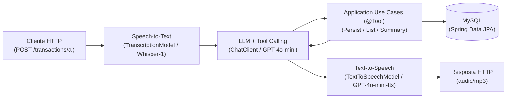

# Budgeting AI API


API REST de controle de orçamento pessoal baseada em **Spring Boot 4** e **Spring AI**, estruturada em camadas (Domain, Application e Infrastructure). O serviço expõe operações CRUD de transações financeiras via HTTP/JSON e um pipeline multimodal de voz (Speech-to-Text, LLM com Tool Calling e Text-to-Speech).

Projeto desenvolvido para o desafio de **Spring AI** da [Digital Innovation One (DIO)](https://www.dio.me/), a partir da trilha [`dio-spring-boot-learning-track`](https://github.com/digitalinnovationone/dio-spring-boot-learning-track/tree/main/05-spring-ai).

---

## Arquitetura e Fluxo Multimodal



1. **Transcrição (STT)**: `TranscriptionModel` converte o arquivo de áudio recebido em texto (`pt`).
2. **Orquestração e Tool Calling**: `ChatClient` avalia o comando e invoca os casos de uso anotados com `@Tool` (`PersistTransactionUseCase`, `ListTransactionsByCategoryUseCase` ou `GetFinancialSummaryUseCase`).
3. **Domínio e Persistência**: Os casos de uso aplicam as regras da entidade `Transaction` e persistem/consultam dados via `TransactionRepository` (adaptado por `JpaTransactionRepository`).
4. **Síntese de Voz (TTS)**: `TextToSpeechModel` converte a resposta textual do modelo em fluxo binário `audio/mp3`.

---

## Melhorias Implementadas sobre o Projeto Base

1. **Resumo Financeiro (`GetFinancialSummaryUseCase` / `FinancialSummaryOutput`)**:
   - Nova tool `@Tool(name = "get-financial-summary")` registrada no `ChatClient` para cálculo do volume total de transações, montante global e subtotais por categoria (`GROCERIES`, `PHARMA`, `AUTO`).
   - Endpoint REST `GET /transactions/summary`.
2. **Invariantes de Domínio e Tratamento HTTP**:
   - Validação no construtor de `Transaction` (descrição não vazia, `amount > 0` e `category != null`).
   - Mapeamento de `IllegalArgumentException` para `400 Bad Request` no `TransactionController`.
3. **Refinamento de System Prompt (`system-message.st`)**:
   - Diretrizes de categorização, uso da tool de resumo e formatação de respostas concisas para síntese de voz.
4. **Testes Unitários Isolados**:
   - Testes de domínio, casos de uso e controller (`TransactionTest`, `FinancialUseCasesTest`, `TransactionControllerTest`) executáveis sem dependência de rede ou `OPENAI_API_KEY`.

---

## Estrutura de Diretórios

```text
dio-spring-ai-budgeting/
├── .github/workflows/ci.yml          # Pipeline de integração contínua (GitHub Actions)
├── docs/
│   ├── tutoriais/                    # Documentação técnica das 12 etapas do projeto
│   ├── EVOLUTION-ROADMAP.md          # Escopo evolutivo e backlog técnico
│   ├── INSTRUCOES-FINAIS-VALIDACAO-E-ENTREGA.md
│   └── README-UPSTREAM.md            # Especificação original do módulo
├── src/
│   ├── main/
│   │   ├── java/dio/budgeting/
│   │   │   ├── domain/               # Entidades, objetos de valor, enums e contratos de repositório
│   │   │   ├── application/          # Casos de uso (@Tool) e records de Input/Output
│   │   │   └── infrastructure/       # Controllers REST, entidades JPA e adaptadores de persistência
│   │   └── resources/
│   │       ├── application.properties
│   │       └── prompts/system-message.st
│   └── test/                         # Testes unitários (*Test) e de integração (*IT)
├── compose.yml                       # Definição do serviço MySQL
└── build.gradle
```

---

## Stack Tecnológica

- **Linguagem e Build**: Java 25, Gradle 9.4
- **Framework Base**: Spring Boot 4.0.5 (Web, Data JPA, Docker Compose Support)
- **Inteligência Artificial**: Spring AI 2.0.0-M4 (`spring-ai-starter-model-openai`)
  - Chat / Tool Calling: `gpt-4o-mini`
  - Speech-to-Text: `whisper-1`
  - Text-to-Speech: `gpt-4o-mini-tts`
- **Banco de Dados**: MySQL 9.6
- **Testes**: JUnit 5, AssertJ, Mockito

---

## Execução e Testes

### Pré-requisitos
- JDK 25
- Docker ou Podman Compose
- Variável de ambiente `OPENAI_API_KEY` (necessária para o endpoint `/transactions/ai` e testes `*IT`)

### Comandos

```bash
# Configurar chave da OpenAI
export OPENAI_API_KEY="sk-..."

# Executar aplicação (inicia o container MySQL via compose.yml)
./gradlew bootRun

# Executar apenas testes unitários (sem necessidade de OPENAI_API_KEY)
./gradlew test --tests "dio.budgeting.domain.*" --tests "dio.budgeting.application.*" --tests "dio.budgeting.infrastructure.*"

# Executar suíte completa (unitários + integração com OpenAI)
./gradlew test
```

---

## Referência da API

### 1. Registrar Transação (`POST /transactions`)
```bash
curl -X POST http://localhost:8080/transactions \
  -H "Content-Type: application/json" \
  -d '{"description": "Compras no supermercado", "amount": 15000, "category": "GROCERIES"}'
```

### 2. Listar por Categoria (`GET /transactions/{category}`)
Categorias suportadas: `GROCERIES`, `PHARMA`, `AUTO`.
```bash
curl http://localhost:8080/transactions/GROCERIES
```

### 3. Consultar Resumo Financeiro (`GET /transactions/summary`)
```bash
curl http://localhost:8080/transactions/summary
```
Resposta:
```json
{
  "totalTransactions": 3,
  "totalAmount": 18000.0,
  "totalByCategory": {
    "GROCERIES": 15000.0,
    "PHARMA": 3000.0
  }
}
```

### 4. Processar Comando de Voz (`POST /transactions/ai`)
```bash
curl -X POST http://localhost:8080/transactions/ai \
  -F "file=@src/test/resources/audio/recording-1.m4a" \
  --output resposta-assistente.mp3
```
