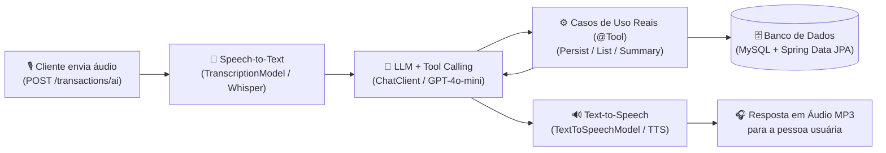

# 💰 Budgeting AI API — Spring Boot & Spring AI


Projeto desenvolvido e evoluído como parte do **Desafio de Projeto de Spring AI** da [Digital Innovation One (DIO)](https://www.dio.me/), baseado na trilha oficial [`dio-spring-boot-learning-track`](https://github.com/digitalinnovationone/dio-spring-boot-learning-track/tree/main/05-spring-ai).

---

## 📌 O Que o Projeto Faz

A **Budgeting AI API** é uma API REST inteligente de controle de orçamento pessoal que utiliza **Spring AI** para processar comandos de voz relacionados a transações financeiras, mantendo uma arquitetura limpa e separação de responsabilidades (Domain, Application e Infrastructure).

### Fluxo Principal da API



1. **Recebimento de áudio**: O cliente envia um arquivo de voz com um comando financeiro (ex.: *"Gastei 45 reais na farmácia"*, *"Quais foram meus gastos no mercado?"* ou *"Qual é o resumo geral dos meus gastos?"*).
2. **Transcrição (Speech-to-Text)**: O `TranscriptionModel` converte o áudio em texto em português.
3. **Interpretação e Tool Calling**: O `ChatClient` analisa a intenção da mensagem e aciona automaticamente o caso de uso adequado (`PersistTransactionUseCase`, `ListTransactionsByCategoryUseCase` ou `GetFinancialSummaryUseCase`) anotado com `@Tool`.
4. **Execução e Persistência**: A regra de negócio executa a criação, listagem ou consolidação no banco de dados MySQL.
5. **Síntese de Voz (Text-to-Speech)**: O `TextToSpeechModel` converte a resposta textual da IA em um arquivo `audio.mp3` retornado ao cliente.

---

## ✨ Melhoria Implementada (Evolução do Desafio)

Para evoluir o projeto base mantendo a arquitetura limpa (DDD / Clean Architecture), foram implementadas **4 melhorias integradas**:

1. **Nova Tool e Caso de Uso de Resumo Financeiro (`GetFinancialSummaryUseCase` + `FinancialSummaryOutput`)**:
   - Nova ferramenta `@Tool(name = "get-financial-summary")` registrada no `ChatClient` para permitir que a pessoa usuária consulte por voz o total geral gasto, a quantidade total de transações e o subtotal agrupado por categoria (`GROCERIES`, `PHARMA`, `AUTO`).
   - Novo endpoint REST `GET /transactions/summary` no `TransactionController`.
2. **Validações de Domínio na Entidade `Transaction` + Tratamento HTTP 400**:
   - Validação de regras de negócio diretamente no construtor de `Transaction` (descrição obrigatória, valor positivo `amount > 0` e categoria não nula).
   - Handler `@ExceptionHandler(IllegalArgumentException.class)` no `TransactionController` retornando `400 Bad Request` com mensagem clara.
3. **Evolução do System Prompt (`system-message.st`)**:
   - Instruções aprimoradas para orientar o modelo no uso da ferramenta `get-financial-summary` e gerar respostas concisas e naturais para síntese de voz em português brasileiro.
4. **Testes Unitários Automatizados (`TransactionTest`, `FinancialUseCasesTest` e `TransactionControllerTest`)**:
   - Suíte completa de testes unitários para validar as regras de domínio, casos de uso (`PersistTransactionUseCase`, `ListTransactionsByCategoryUseCase` e `GetFinancialSummaryUseCase`) e endpoints do `TransactionController` (incluindo o fluxo multimodal `/transactions/ai` com mocks), sem depender de chave externa da OpenAI.

---

## 🏗️ Estrutura do Projeto

```text
dio-spring-ai-budgeting/
├── .github/
│   ├── workflows/ci.yml              # Pipeline de CI com GitHub Actions
│   └── PULL_REQUEST_TEMPLATE.md      # Template padrão de Pull Request
├── docs/
│   ├── tutoriais/                    # 12 tutoriais passo a passo ordenados por aula/vídeo
│   ├── EVOLUTION-ROADMAP.md          # Ideias e checklist de evolução do desafio
│   └── README-UPSTREAM.md            # Documentação original da trilha DIO
├── src/
│   ├── main/
│   │   ├── java/dio/budgeting/
│   │   │   ├── domain/               # Entidades de domínio (com validações), Category e contratos
│   │   │   ├── application/          # Casos de uso (@Tool) e DTOs de entrada/saída
│   │   │   └── infrastructure/       # Controllers REST, JPA Entities e Repositórios
│   │   └── resources/
│   │       ├── application.properties
│   │       └── prompts/system-message.st
│   └── test/                         # Testes unitários (domain/application) e de integração (IT)
├── .env.example                      # Exemplo de configuração de variáveis de ambiente
├── compose.yml                       # Container MySQL gerenciado pelo Spring Boot Docker Compose
├── build.gradle                      # Dependências e configuração do Gradle
└── README.md                         # Documentação principal do projeto
```

---

## 🛠️ Tecnologias Utilizadas

- **Java 25** & **Gradle**
- **Spring Boot 4.0.5** (`spring-boot-starter-web`, `spring-boot-starter-data-jpa`, `spring-boot-docker-compose`)
- **Spring AI 2.0.0-M4** (`spring-ai-starter-model-openai`):
  - `ChatClient` / `ChatModel` (`gpt-4o-mini`)
  - `TranscriptionModel` (`whisper-1`)
  - `TextToSpeechModel` (`gpt-4o-mini-tts`)
  - `@Tool` / `@ToolParam` para execução de funções reais da aplicação
- **MySQL** (via Docker Compose)
- **Lombok** & **JUnit 5 / AssertJ**

---

## 🚀 Como Executar a Aplicação

### Pré-requisitos
- **JDK 25** instalado
- **Docker** e **Docker Compose** ativos (o Spring Boot iniciará o container MySQL automaticamente via `compose.yml`)
- Uma chave de API da OpenAI (`OPENAI_API_KEY`)

### Passo a Passo

1. **Configure a variável de ambiente da OpenAI**:
   ```bash
   export OPENAI_API_KEY="sua_chave_aqui"
   ```

2. **Execute a aplicação com Gradle**:
   ```bash
   ./gradlew bootRun
   ```

3. **Execute os testes unitários (não requerem chave da OpenAI)**:
   ```bash
   ./gradlew test --tests "dio.budgeting.domain.*" --tests "dio.budgeting.application.*" --tests "dio.budgeting.infrastructure.*"
   ```

4. **Execute todos os testes (incluindo integração com OpenAI)**:
   ```bash
   ./gradlew test
   ```

---

## 🧪 Como Testar o Fluxo Principal

### 1. Criar uma transação via REST (`POST /transactions`)
```bash
curl -X POST http://localhost:8080/transactions \
  -H "Content-Type: application/json" \
  -d '{
    "description": "Compras no supermercado",
    "amount": 15000,
    "category": "GROCERIES"
  }'
```

### 2. Consultar transações por categoria (`GET /transactions/{category}`)
Categorias disponíveis: `GROCERIES`, `PHARMA`, `AUTO`.
```bash
curl http://localhost:8080/transactions/GROCERIES
```

### 3. Consultar o resumo financeiro consolidado (`GET /transactions/summary`) *(Novo!)*
```bash
curl http://localhost:8080/transactions/summary
```
Exemplo de resposta JSON:
```json
{
  "totalTransactions": 3,
  "totalAmount": 18000.0,
  "totalByCategory": {
    "GROCERIES": 15000.0,
    "PHARMA": 3000.0
  }
}
```

### 4. Enviar comando de voz para o Assistente de IA (`POST /transactions/ai`)
Você pode usar os arquivos de áudio de exemplo disponíveis em `src/test/resources/audio/`:
```bash
curl -X POST http://localhost:8080/transactions/ai \
  -F "file=@src/test/resources/audio/recording-1.m4a" \
  --output resposta-assistente.mp3
```

---

## 📚 Aprendizados Durante o Desafio

- Integração prática do **Spring AI** (`ChatClient`, `TranscriptionModel` e `TextToSpeechModel`) em uma aplicação Spring Boot.
- Uso de **Tool Calling (`@Tool`)** para conectar decisões de um LLM diretamente aos casos de uso da camada `application`, preservando o isolamento do domínio.
- Evolução da API adicionando novas ferramentas ao `ChatClient`, validações de domínio e testes unitários desacoplados de provedores externos.
